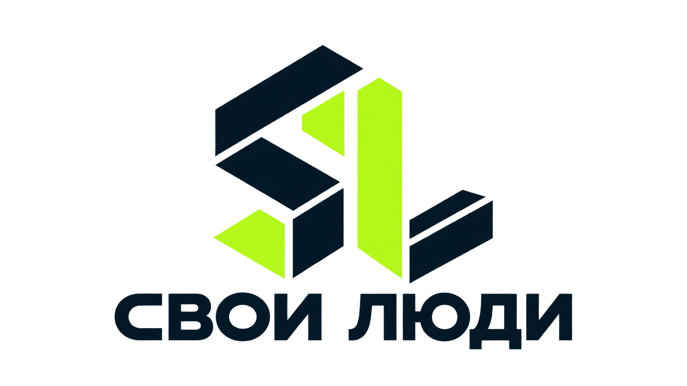

# Серверное подключение Google Drive — этап авторизации

Этот этап добавляет подключение и контрольное чтение API Drive, **не автосохранение проектов**. Существующие localStorage, JSON-экспорт, Google Sheets и вход владельца сохраняются. Тестовый токен из кабинета Vercel не передаётся сайту и не заменяет пользовательский grant приложения.

## Настройка владельца

1. В Google Auth Platform используйте OAuth web client с полным Client ID и текущим секретом. Redirect URI для Vercel Connect: `https://connect.vercel.com/callback`. В режиме Testing добавьте собственный Google-аккаунт в Test users. Перед постоянной эксплуатацией отдельно проверьте требования публикации/верификации и срок действия refresh token в Testing.
2. Создайте Google connector с этими данными в Vercel Connect. Не публикуйте секрет, пароли, OAuth URL со state, runtime-токены или JSON credentials.
3. Скопируйте **фактический UID** созданного connector, например `google/<имя>`, или его точный ID `scl_…` из карточки. Не используйте название вместо UID/ID, неполный Google Client ID, старый connector с ошибочными настройками или предполагаемое значение.
4. Привяжите именно этот connector к проекту, который обслуживает помощника, и Production. Привязка другого connector не даёт доступ новому. Для Preview/Development нужна отдельная явная привязка.
5. Добавьте в серверное окружение `GOOGLE_DRIVE_CONNECTOR_UID` с проверенным UID, затем пересоберите deployment. Секрет Google хранится в Connect, а не в этом env и не в браузере. Vercel workload OIDC используется SDK автоматически. В текущей рабочей среде живой workload identity не настроен; локальные unit-тесты не доказывают доступ production.
6. Войдите в помощника, нажмите «Подключить Google Drive», завершите согласие Google, вернитесь в помощника и нажмите «Проверить подключение».

Оба серверных запроса используют строго `openid` и `https://www.googleapis.com/auth/drive.file`, стабильный subject подписанной сессии `owner` и один настроенный UID. POST требует действующую сессию и same-origin. Внешние subject, callback и scopes не принимаются. GET не вызывает провайдера. SDK управляет state/PKCE/refresh; приложение не принимает callback-код или токен из URL. Успешный redirect сам по себе не меняет статус на connected.

Проверка получает токен на сервере, делает безопасное чтение Drive `files.list` с `fields=kind` и проверяет `drive#fileList`. Файлы не загружаются и не изменяются, их названия не выгружаются. Успешный тест означает только доступ API; он не доказывает сохранение конкретного документа, доступ ко всем старым папкам или фоновое резервирование. `drive.file` охватывает файлы приложения и явно выбранные пользователем файлы; папки, ранее созданные другим OAuth-приложением, требуют отдельного предоставления доступа.

## Проверки перед включением

- Несанкционированные и cross-site запросы отклоняются до обращения к SDK.
- При новом логине owner остаётся тем же; session ID и введённая фамилия не используются для OAuth.
- В запросе всегда заданы оба scopes; адрес почты не является scope.
- Секреты, vendor error body, verifier и токены не возвращаются и не пишутся в логи.
- Отдельно проверяются отсутствие grant, ошибочная привязка проекта, отказ Drive и неправильный ответ провайдера.
- Реальный consent/refresh, опубликованная привязка и прочтение Drive должны проверяться владельцем в Production. До этого этап остаётся подготовленным, а не подтверждённым live.

Дальше отдельно реализуются связь файлов со стабильными ID объектов, неизменяемые версии, подтверждение размера/хеша, выборочное восстановление/корзина и журнал операций. Не включайте обещание автосохранения или перенос учёта до этих проверок.

Официальные источники: [Vercel Connect Quickstart](https://vercel.com/docs/connect/quickstart), [SDK](https://vercel.com/docs/connect/ts-sdk-reference), [Drive scopes](https://developers.google.com/workspace/drive/api/guides/api-specific-auth).
